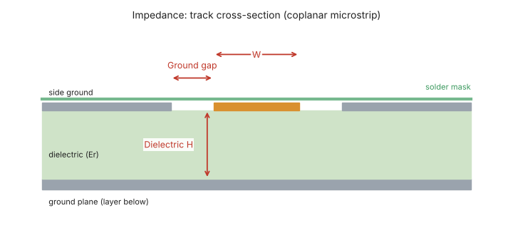
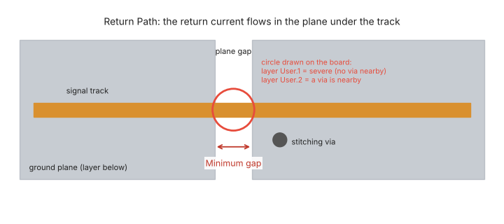
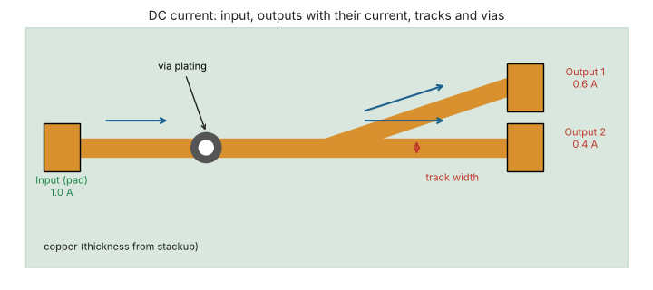
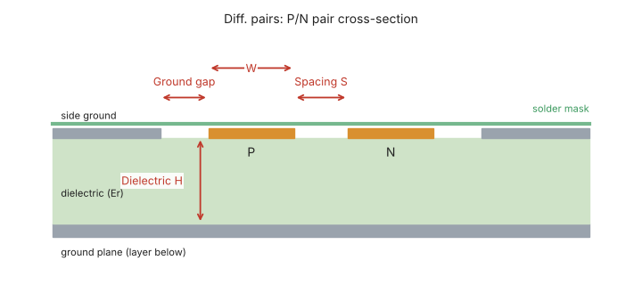
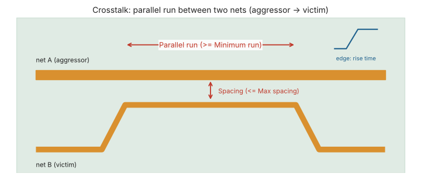
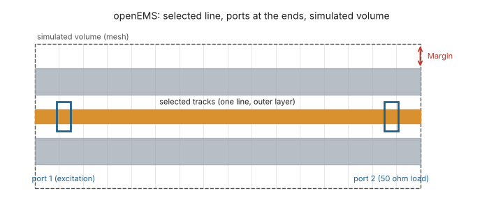

# PCB Signal Integrity Toolkit for KiCad

A KiCad 10 plugin (Pcbnew) that brings together signal- and power-integrity checks on the board you are designing:

| Tab | What it does |
|---|---|
| **Return Path** | Finds tracks that cross gaps in the reference plane underneath, and marks them on the board. **Return map (HF)** shows where the high-frequency return current of a selected line flows in the plane and how it detours around gaps |
| **DC Current** | Solves the resistive network of tracks and vias: current, IR drop, density and IPC-2221 limit, with one or more loads and a color map |
| **Impedance** | Z0 of every track with a 2D field solver, from the real board stackup (coplanar ground, solder mask) |
| **Diff. pairs** | Differential and common-mode impedance with the field solver (odd/even modes) |
| **Crosstalk** | Parallel runs between different nets and estimated NEXT |
| **openEMS** | 3D FDTD electromagnetic simulation of a line with [openEMS](https://www.openems.de): S-parameters, impedance, TDR/TDT and animated field GIFs |

The interface is available in **English** and **Italian** (Options tab), and every tab has a **?** button with an explanatory drawing.

## Installation

### From the Plugin and Content Manager (recommended)
1. Download `si_toolkit_pcm_x.y.z.zip` from the [Releases](../../releases) page.
2. In KiCad open **Plugin and Content Manager → Install from File...**, choose the zip and press **Apply Pending Changes**.
3. Restart Pcbnew: the plugin appears in the toolbar and in **Tools → External Plugins**.

### Manually
Copy the `si_toolkit` folder into the KiCad user plugin folder, for example
`Documents\KiCad\10.0\scripting\plugins\si_toolkit`, then restart Pcbnew.

Settings are stored in the KiCad user configuration folder (`si_toolkit_settings.json`), so they survive plugin updates.

## openEMS (optional, only for the openEMS tab)
The plugin does **not** install openEMS. All other tabs work with KiCad's own Python.

1. Download openEMS for Windows from the official openEMS releases and extract it (e.g. `D:\Programs\openEMS`).
2. Install a 64-bit Python supported by that openEMS release.
3. In the **Options** tab set the Python and the openEMS folder, then press **Check openEMS**.
4. If something is missing (numpy, h5py, matplotlib, or the CSXCAD/openEMS modules from the `.whl` files of the openEMS distribution), **Install missing packages** installs it after confirmation.

## The tabs at a glance

| | |
|---|---|
|  |  |
|  |  |
|  | |

## Limits
- Except for openEMS the analyses are quasi-static: they are meant to compare options and find problems, not to replace measurements.
- With *Copper zones = zero resistance* the DC result is optimistic; without it, pessimistic.
- Tested on KiCad 10 under Windows.

## For developers
- `si_toolkit/tools/build_pcm.py` builds the Plugin Manager package (increase `VERSION` first).
- `si_toolkit/tools/make_help_images.py` regenerates the help drawings (needs matplotlib).
- UI texts are written in Italian in the code and translated through `common/i18n_en.py`.

## License
[MIT](LICENSE) © 2026 Ugo Silato

## Code comments translated by Claude
---

## In italiano

Plugin per KiCad 10 che raccoglie in un'unica finestra i controlli di integrità del segnale e dell'alimentazione: **Return Path** (piano di riferimento interrotto sotto le tracce, con mappa della corrente di ritorno ad alta frequenza), **Corrente DC** (corrente, caduta IR e limite IPC-2221 con più carichi e mappa a colori), **Impedenza** e **Coppie differenziali** con risolutore di campo 2D dallo stackup reale, **Crosstalk** e simulazione elettromagnetica 3D con **openEMS** (parametri S, impedenza, TDR/TDT, GIF del campo).

**Installazione:** scarica `si_toolkit_pcm_x.y.z.zip` dalla pagina [Releases](../../releases) e in KiCad usa *Gestore di plugin e contenuti → Installa da file...*. In alternativa copia la cartella `si_toolkit` in `Documenti\KiCad\10.0\scripting\plugins`.

**openEMS** va installato a parte (serve solo alla scheda openEMS): nella scheda *Opzioni* indica Python e cartella di openEMS e premi *Verifica openEMS*, che dice cosa manca e può installare i pacchetti mancanti.

La lingua dell'interfaccia si sceglie nella scheda *Opzioni* (inglese predefinito, oppure italiano); ogni scheda ha un pulsante **?** con un disegno che spiega i dati da inserire.
