# PCB Signal Integrity Toolkit for KiCad

A KiCad 10 plugin (Pcbnew) that brings together signal- and power-integrity checks on the board you are designing:

| Tab | What it does |
|---|---|
| **Layout checks** | A smart DRC on the whole board: distance of the decoupling capacitors from the IC supply pins and their ground vias, signal vias that change reference plane without a ground via nearby, stitching via spacing on multi-layer ground, tracks over plane gaps, tracks close to the edge of their reference plane, track width against the current (IPC-2221), isolation between nets above 30 V (IPC-2221), length difference of differential pairs and net groups, dead branches, acute angles, width steps, vias in SMD pads, tombstoning risk, number of vias for the current, crystal placement, overlapping tracks on adjacent layers. Every row is a measure compared with a threshold, marked on the board |
| **Return Path** | Finds tracks that cross gaps in the reference plane underneath, and marks them on the board. **Return map** (HF and DC) shows where the return current of a line flows in the ground, from its loads to the chosen ground exit |
| **DC Current** | Solves the resistive network of tracks and vias: current, IR drop, density and IPC-2221 limit, with one or more loads and a color map |
| **Impedance** | Z0 of every track with a 2D field solver, from the real board stackup (coplanar ground, solder mask) |
| **Diff. pairs** | Differential and common-mode impedance with the field solver (odd/even modes) |
| **Crosstalk** | Parallel runs between different nets and estimated NEXT |
| **openEMS** | 3D FDTD electromagnetic simulation of a line with [openEMS](https://www.openems.de): S-parameters, impedance, TDR/TDT and animated field GIFs |

The interface is available in **English** and **Italian** (Options tab), and every tab has a **?** button with an explanatory drawing.

## Return current map

Give the pad where the current enters and the ground pad where it leaves the board (e.g. the supply ground): the plugin finds the net and every load with a ground pin, also beyond series parts, estimates the current of each one from its type and value (TVS 0, resistor V/R, capacitor V/|Z|, MOSFET gate almost 0, collector V/(series R + pull-up) ...) and lets you check and correct it in a table. The map then shows, layer by layer, where the return flows in planes, coplanar ground and vias, at high frequency (it follows the track) or in DC (minimum resistance), with the share of every ground pin and via. Components and the tracks of the other nets can be drawn over the map to find your way. The currents are an estimate, not a circuit simulation: the result is theoretical.

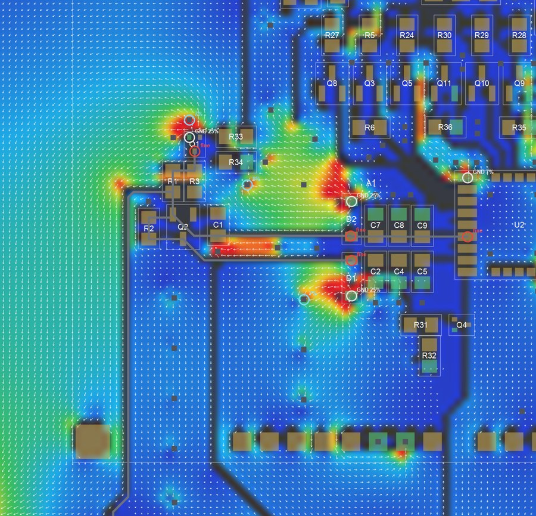

## Layout checks

A smart DRC that **measures** the layout instead of predicting physical quantities: every row of the table is a fact about the board, with the **Measured** value next to the **Limit** it is compared with, a circle on the board (User.1 = errors, User.2 = warnings) and, for the plane edge, the measured segment with its value. Clicking a row selects the objects in Pcbnew. Currents, voltages and length groups are typed in the tab as `net = value; ...` (wildcards `*` and `?` allowed).

- **Exclude a row**: right click → *Exclude (accepted)*. The row turns grey and goes to the bottom, as KiCad does with excluded DRC errors; it is not counted and not drawn on the board, and it stays excluded in the next runs until the objects involved are edited.
- **Per-board data**: excluded rows and net data are saved next to the board in `board_name.si_toolkit.json`; thresholds stay global.
- **Report**: *Report...* writes `board_name_layout_checks.html` next to the board, with summary, thresholds, a drawing of the board with numbered problems and a zoomed drawing for every problem (print it to PDF from the browser).
- **Test board**: `docs/test_board` has a board with one case for each check and the list of expected rows.

| | |
|---|---|
| 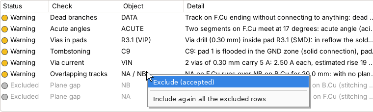 | 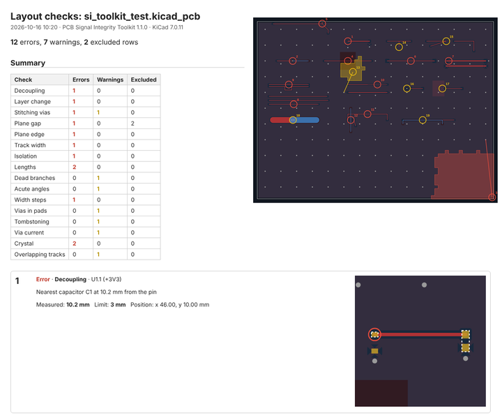 |

| | |
|---|---|
| 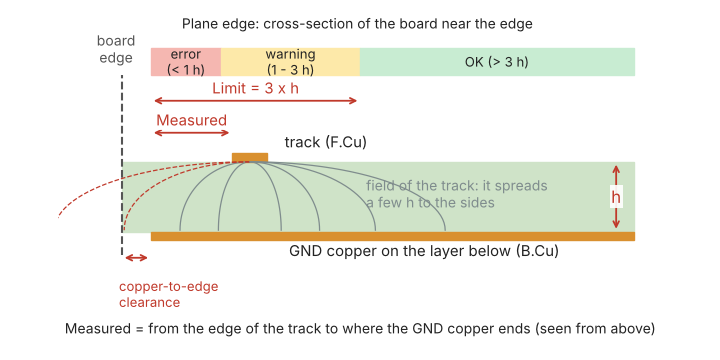 **Plane edge**: Measured = from the edge of the track to where the ground copper of the adjacent layer really ends; Limit = 3 × h (dielectric height). Holes around pads/vias and narrow cuts made by tracks of the plane layer are not an edge. | 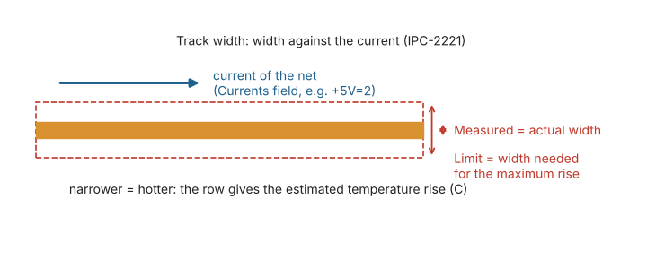 **Track width**: Measured = actual width; Limit = IPC-2221 width for the current of the net and the allowed temperature rise. |
| 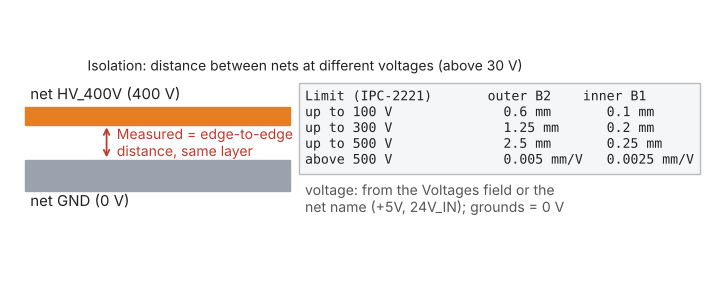 **Isolation**: Measured = edge-to-edge copper distance on the same layer between nets more than 30 V apart; Limit = IPC-2221 table (B2 outer, B1 inner). | 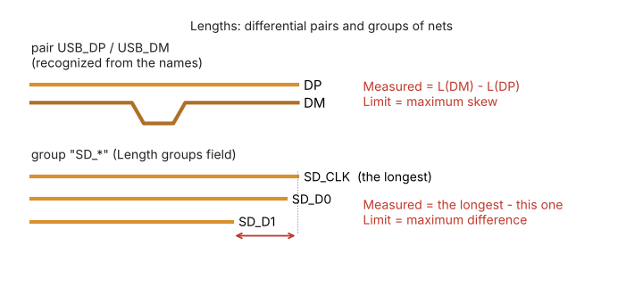 **Lengths**: skew of the differential pairs (found from the names) and difference from the longest net of each group. |
| 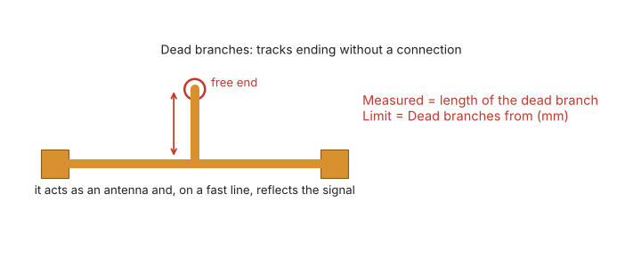 **Dead branches**: tracks ending without connecting to anything; Measured = length of the dead branch. Tracks are connected when their copper touches, as in KiCad. | 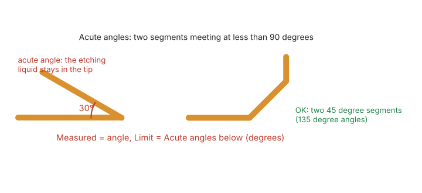 **Acute angles**: segments of the same net meeting at less than 90° (acid traps); micro segments and overlaps are ignored. |
| 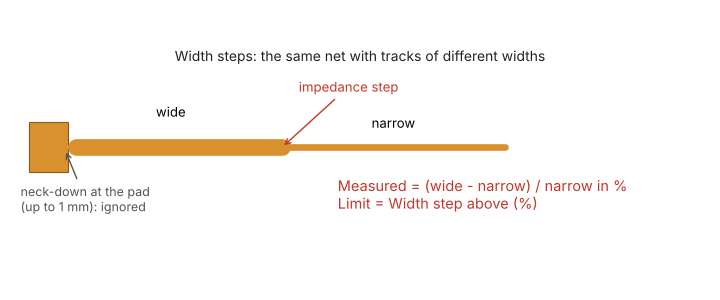 **Width steps**: a signal net with tracks of different widths on a layer; Measured = (wide − narrow) / narrow in %. Neck-downs at pads are ignored. | 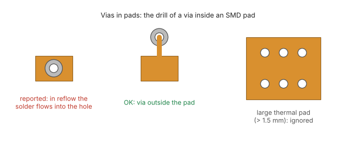 **Vias in pads**: via drills inside SMD pads (solder wicking); large thermal pads are ignored. |
| 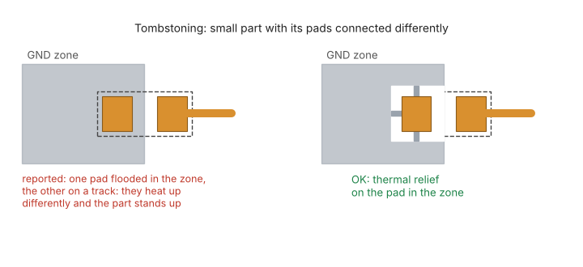 **Tombstoning**: small two-pad parts with one pad flooded in a zone and the other on a track. | 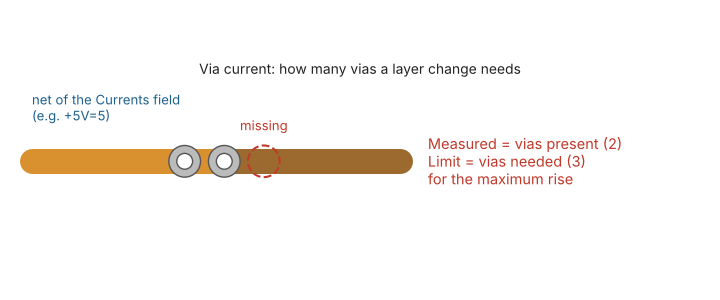 **Via current**: Measured = vias at a layer change, Limit = vias needed by IPC-2221 for the current of the net. |
| 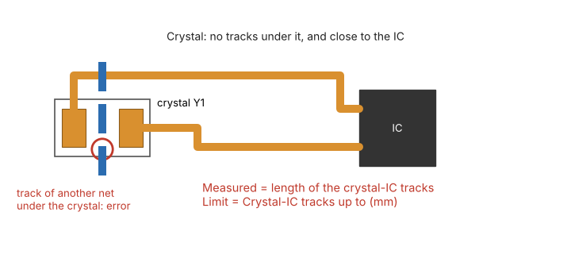 **Crystal**: tracks of other nets under a crystal, and length of the crystal–IC tracks. | 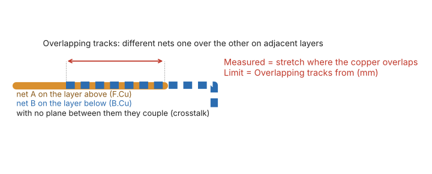 **Overlapping tracks**: different nets one over the other on adjacent layers; Measured = overlap length. |

## Installation

### From the Plugin and Content Manager (recommended)
1. Download `si_toolkit_pcm_x.y.z.zip` from the [Releases](../../releases) page.
2. In KiCad open **Plugin and Content Manager → Install from File...**, choose the zip and press **Apply Pending Changes**.
3. Restart Pcbnew: the plugin appears in the toolbar and in **Tools → External Plugins**.

### Manually
Copy the `si_toolkit` folder into the KiCad user plugin folder, for example
`Documents\KiCad\10.0\scripting\plugins\si_toolkit`, then restart Pcbnew.

Settings are stored in the KiCad user configuration folder (`si_toolkit_settings.json`), so they survive plugin updates.

## openEMS (optional, only for the openEMS tab)
The plugin does **not** install openEMS. All other tabs work with KiCad's own Python.

1. Download openEMS for Windows from the official openEMS releases and extract it (e.g. `D:\Programs\openEMS`).
2. Install a 64-bit Python supported by that openEMS release.
3. In the **Options** tab set the Python and the openEMS folder, then press **Check openEMS**.
4. If something is missing (numpy, h5py, matplotlib, or the CSXCAD/openEMS modules from the `.whl` files of the openEMS distribution), **Install missing packages** installs it after confirmation.

## The tabs at a glance

| | |
|---|---|
|  |  |
|  |  |
|  | 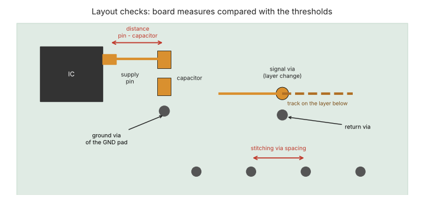 |

## Limits
- Except for openEMS the analyses are quasi-static: they are meant to compare options and find problems, not to replace measurements.
- With *Copper zones = zero resistance* the DC result is optimistic; without it, pessimistic.
- **Layout checks**: the default thresholds are good-practice rules for a generic board (decoupling capacitor within 3 mm of the pin, error beyond 8 mm; ground via within 1 mm of a GND pad; return via within 2 mm of a signal via that changes reference plane; stitching vias every 10 mm; plane gaps from 5 mm; plane edge at least 3 h from the track; 10 °C track temperature rise; pair skew 0.5 mm, groups within 2 mm; dead branches from 1 mm; acute angles below 90°; width steps above 25 %; crystal–IC tracks up to 10 mm; overlapping tracks from 5 mm). Currents, voltages and length groups are typed in the tab as `net = value; ...` (wildcards allowed); voltages are otherwise read from the net names. Known limits: the capacitor considered is the nearest one on the same supply, whatever its value; the layer change check covers all the signals, slow ones too, so many warnings can be ignored; one stitching spacing for the whole board (RF areas such as a 1.5 GHz GNSS need about 5 mm: run a second check); only ground planes are considered as reference; distances are straight-line; stitching areas follow a 1-2 mm grid; the plane edge is measured to the real ground fill, ignoring cuts up to 2 mm wide made by the tracks of the plane layer (on a two-layer board h is about 1.5 mm, so the 3 h limit is about 4.5 mm and also reports tracks a few mm from the board edge); the track width check assumes the whole current of the net on every track; IPC-2221 isolation distances are a PCB design minimum, mains safety standards (IEC 62368-1, IEC 60664) ask for more; lengths include every branch of the net; width steps, dead branches, acute angles and overlapping tracks look at all the signal nets, slow ones too; a crystal is recognized only from the Y reference or the footprint name.
- Tested on KiCad 10 under Windows.

## For developers
- `si_toolkit/tools/build_pcm.py` builds the Plugin Manager package (increase `VERSION` first).
- `si_toolkit/tools/make_help_images.py` regenerates the help drawings (needs matplotlib).
- `si_toolkit/tools/make_test_board.py` regenerates the test board in `docs/test_board` (needs the pcbnew module, e.g. KiCad's Python).
- The version is written only in `si_toolkit/common/version.py`.
- UI texts are written in Italian in the code and translated through `common/i18n_en.py`.

## What's new in 1.2.0

- **Layout checks** tab: a smart DRC on the whole board with 16 checks, every row a measure compared with a limit (with its unit) and marked on the board: decoupling, layer change, stitching vias, plane gap, plane edge (measured to the real ground fill), track width vs current, isolation (IPC-2221), lengths (pair skew and groups), dead branches, acute angles, width steps, vias in SMD pads, tombstoning, via current, crystal placement, overlapping tracks on adjacent layers.
- Rows can be **excluded** with a right click (greyed, as in KiCad's DRC) and stay excluded in the next runs.
- **Per-board data**: excluded rows, currents, voltages and length groups saved next to the board (`board_name.si_toolkit.json`).
- **HTML report** with summary, thresholds and a drawing of every reported point (printable to PDF).
- **Test board** in `docs/test_board` with one case for each check and the expected rows.
- **All / None** buttons for the checks; help with one drawing per check, in English and Italian.
- Return Path tab: return current map (HF and DC) with loads found and estimated automatically.

## License
[MIT](LICENSE) © 2026 Ugo Silato

## Code comments translated by Claude
---

## In italiano

Plugin per KiCad 10 che raccoglie in un'unica finestra i controlli di integrità del segnale e dell'alimentazione: **Controlli layout** (un DRC ragionato su tutta la scheda: distanza dei condensatori di disaccoppiamento e loro via di massa, cambi di layer senza via di ritorno, passo delle via di stitching, tracce sopra interruzioni del piano, tracce vicine al bordo del piano, larghezza delle tracce rispetto alla corrente, distanze di isolamento fra net ad alta tensione, lunghezze di coppie differenziali e gruppi di net, rami morti, angoli acuti, cambi di larghezza, via nei pad SMD, rischio di tombstoning, numero di via per la corrente, posizione del quarzo, tracce sovrapposte su layer adiacenti; soglie predefinite pensate per una scheda generica, limiti spiegati nella guida del plugin; ogni riga riporta la *Misura* trovata sulla scheda e il *Limite* con cui è confrontata, e la guida ha un disegno per ogni controllo che mostra cosa si misura; una riga accettata si esclude con il clic destro e diventa grigia come nel DRC di KiCad; righe escluse e dati delle net si salvano accanto alla scheda; il pulsante *Rapporto...* crea una pagina HTML, stampabile in PDF, con i disegni dei punti segnalati; in `docs/test_board` c'è una scheda di prova con un caso per ogni controllo), **Return Path** (piano di riferimento interrotto sotto le tracce, con mappa della corrente di ritorno in alta frequenza e in continua, dall'ingresso fino all'uscita di massa, con correnti dei carichi stimate dal tipo e dal valore dei componenti), **Corrente DC** (corrente, caduta IR e limite IPC-2221 con più carichi e mappa a colori), **Impedenza** e **Coppie differenziali** con risolutore di campo 2D dallo stackup reale, **Crosstalk** e simulazione elettromagnetica 3D con **openEMS** (parametri S, impedenza, TDR/TDT, GIF del campo).

**Installazione:** scarica `si_toolkit_pcm_x.y.z.zip` dalla pagina [Releases](../../releases) e in KiCad usa *Gestore di plugin e contenuti → Installa da file...*. In alternativa copia la cartella `si_toolkit` in `Documenti\KiCad\10.0\scripting\plugins`.

**openEMS** va installato a parte (serve solo alla scheda openEMS): nella scheda *Opzioni* indica Python e cartella di openEMS e premi *Verifica openEMS*, che dice cosa manca e può installare i pacchetti mancanti.

**Novità della 1.2.0:** scheda *Controlli layout* con 16 controlli (misura e limite per ogni riga), righe escludibili con il clic destro, dati salvati per ogni scheda, rapporto HTML/PDF con i disegni, scheda di prova in `docs/test_board`, pulsanti *Tutti* / *Nessuno*, mappa della corrente di ritorno nella scheda Return Path.

La lingua dell'interfaccia si sceglie nella scheda *Opzioni* (inglese predefinito, oppure italiano); ogni scheda ha un pulsante **?** con un disegno che spiega i dati da inserire.
